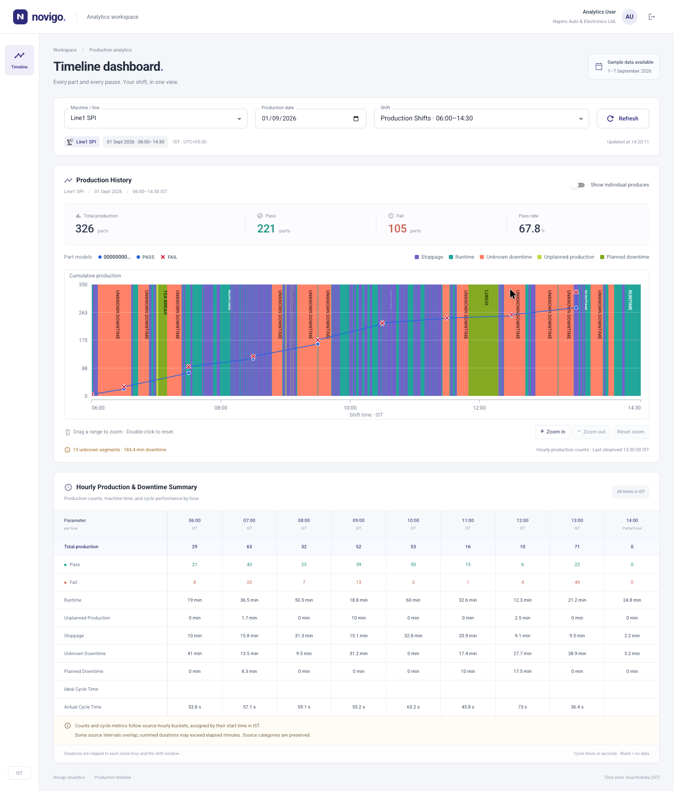

# Novigo · Timeline Dashboard

A React 18 + TypeScript production analytics dashboard, built with Vite and MUI v6 against the assignment's real backend.



## Run locally

Requires Node.js 22+ and npm.

```bash
npm install
cp .env.example .env.local
npm run dev
```

Open the localhost URL printed by Vite. Sign in with the assignment account:

- Username: `analytics_user`
- Password: `dashboard123`

The initial selection is **Line1 SPI**, **1 September 2026**, and the first shift returned by the API. Data is available for **1–7 September 2026**. Dates outside this range can return no data.

`VITE_API_BASE_URL=/api` uses the local development proxy and Vercel serverless transport. `BACKEND_BASE_URL` changes the upstream server; it defaults to `https://13.207.251.55.nip.io`. A direct `VITE_API_BASE_URL` can also be used if that server allows your origin through CORS. Neither variable should contain secrets.

## Validate

```bash
npm test
npm run build
# Optional: exercise the Vercel handler locally against all seven live endpoints
npm run smoke:api
```

Vitest covers session/API behavior, retry/cancellation, the serverless transport, IST shift windows, partial hours, interval clipping, multi-model counts, and future buckets. Browser verification and the 20,000-marker performance exercise are described in [QA.md](QA.md). Design decisions and live backend limitations are in [NOTES.md](NOTES.md).

## Use the dashboard

- Choose one asset, date, and API-defined shift. The label shows the shift's IST start and end; a `+1 day` badge identifies overnight shifts.
- Enable **Show individual produces** to request exact timestamps. With it off, production markers use hourly counts.
- Drag across the chart to zoom; double-click or choose **Reset zoom** to restore the full shift. **Zoom in** and **Zoom out** provide keyboard and touch alternatives.
- Hover a marker for result, time, cumulative count, part model, and produce ID. Focus the chart and use the arrow keys to inspect markers; `+`, `-`, and `R` control zoom.
- Use **Refresh** to refetch, and the header's sign-out action to end the session. There is no polling.

## Deployment

Deploy this repository as a **Vite** project on Vercel. The included `vercel.json` routes client-side pages to `index.html` and `/api/*` to `api/proxy.js`. The function forwards only the seven assignment endpoints, with the bearer token supplied by the client, without storing or logging it. Large upstream responses are streamed to support exact-produce datasets. This same-origin transport is necessary because the live backend does not return CORS headers for browser requests.

`npm run preview` serves only the static production build. Use `npm run dev` for local API access, or Vercel for the deployed serverless function.

The walkthrough is available at `/demo.html` on the deployed site and as [public/demo.webm](public/demo.webm) in this repository.

## Project structure

```text
api/proxy.js                 Allowlisted Vercel transport
src/context/AuthContext.tsx  Session restoration, login, logout, expiry
src/lib/api.ts               Central API client, headers, envelope/errors, retries
src/lib/time.ts              Explicit IST/UTC conversion and shift derivation
src/lib/data.ts              Shared chart/table normalization and aggregation
src/components/TimelineChart.tsx  Two-layer canvas rendering and interaction
src/components/HourlySummary.tsx  Accessible hourly table
scripts/performance-check.mjs     Isolated 20,000-marker benchmark
```

The original brief, screenshots, and endpoint fixtures are retained in `Frontend Assignment/`.
